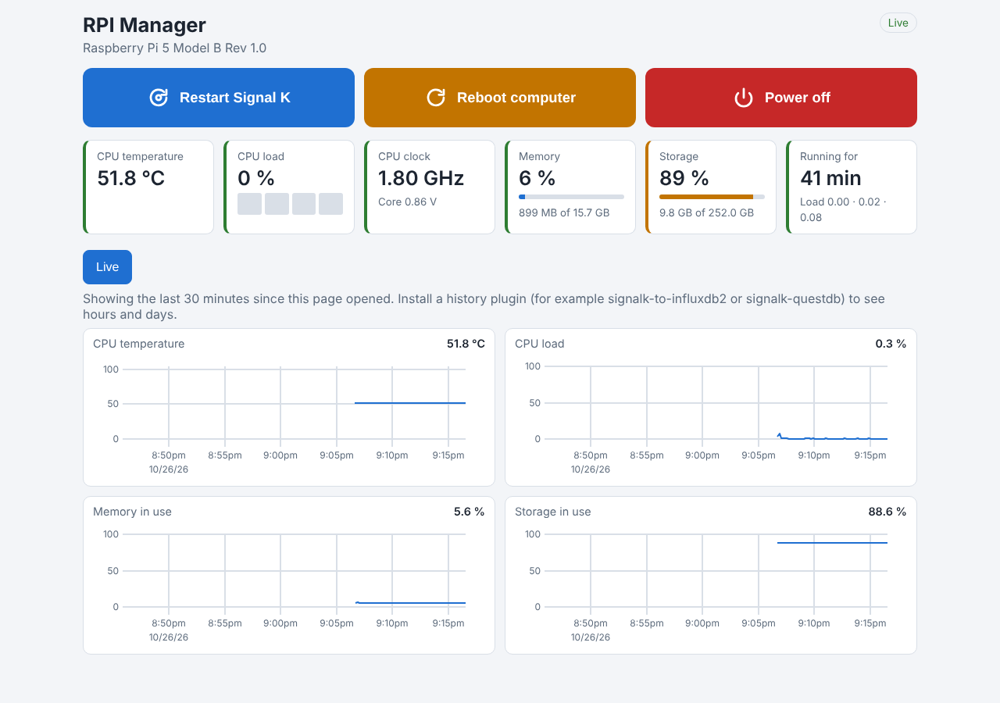

# RPI Manager

A page for the computer that runs your Signal K server: how hot it is, how busy, how full its memory and storage are, and three big buttons to **restart Signal K**, **reboot** or **power off** the computer.



> **Made for the [Signal K Universal Installer](https://github.com/dirkwa/signalk-universal-installer).** The installer sets it up for you, together with the plugins it builds on, and puts it in App Dock right before Settings. On a Signal K server installed some other way the page still shows the computer's health, but the reboot and power-off buttons stay greyed out, because they rely on what the installer sets up on the computer.

## What it shows

- **Power buttons.** Restart Signal K, reboot the computer, or power it off before you leave the boat. Each asks first, and after a restart or reboot the page reconnects by itself.
- **Status.** CPU temperature (amber from 70 °C, red from 80 °C, where a Raspberry Pi starts to slow itself down), CPU load per core, clock speed, memory, storage (amber from 80 %, red from 90 % full), and how long the computer has been running.
- **Power supply warnings.** On a Raspberry Pi, a banner tells you when the supply voltage is too low or the CPU is slowing down because it is too hot. A weak supply is a common cause of corrupted SD cards on boats. These need signalk-rpi-stats to reach the Pi's `vcgencmd`, which a Signal K server running in a container usually cannot.
- **History.** CPU temperature, CPU load, memory and storage as charts. With a history plugin (for example signalk-to-influxdb2 or signalk-questdb) you can look back 1 hour, 24 hours or 7 days; without one the page charts the last 30 minutes since you opened it.

Despite the name it works on any Linux computer. The power-supply warnings and the core voltage are only available on a Raspberry Pi, and only where `vcgencmd` is reachable.

## Where the data comes from

| Feature              | Comes from                                                                                                                                                |
| -------------------- | --------------------------------------------------------------------------------------------------------------------------------------------------------- |
| Measurements         | [signalk-rpi-stats](https://github.com/ryansabin/signalk-rpi-stats), read from the paths it publishes (`environment.rpi.*` unless you changed its prefix) |
| Reboot and power off | The Updater of the Universal Installer (`signalk-updater`), which asks the computer through a rule the installer adds                                     |
| Restart Signal K     | The Updater, or Signal K's own restart when the Updater is not installed                                                                                  |
| History              | The Signal K History API, when a history plugin provides it                                                                                               |

The page is for administrators: you need to be logged in as an admin to use the buttons.

## Install

With the Universal Installer there is nothing to do. Otherwise install **RPI Manager** and **signalk-rpi-stats** from the Signal K App Store and open RPI Manager from the Webapps menu.

## Development

Node 22.18 or newer (the tooling configs are TypeScript that Node runs directly).

```sh
npm install
npm run build:all   # lint, typecheck, build, test
```

- `src/` is the server plugin: it reports which computer it runs on (`GET /plugins/signalk-universal-installer-rpi-mgmt/system`).
- `web/` is the page (React, Zustand, uPlot), built into `public/`.

Both builds fail on type errors (`vite-plugin-checker`).

## License

Apache-2.0
